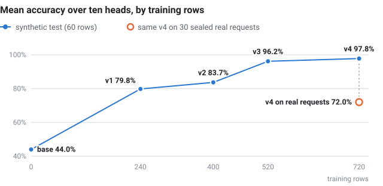
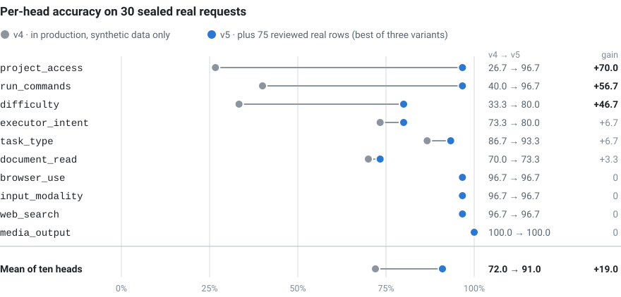

# Model card: Task Router

Task Router is a 322M-parameter multi-head classifier that answers ten routing questions about one request to a multi-agent assistant, in one forward pass. This card covers what it is for, how it is built and trained, how it scores on synthetic and real requests, and where it falls short. For the service that runs it, see [`service/API.md`](service/API.md).

**Contents:** [Model details](#model-details) · [Intended use](#intended-use) · [Architecture](#architecture) · [Training data](#training-data) · [Training procedure](#training-procedure) · [Evaluation](#evaluation) · [Limitations and risks](#limitations-and-risks) · [License and attribution](#license-and-attribution)

## Model details

- **Name:** Task Router (versions v1-v5). Production runs v4; v5 is evaluated and rolling out next.
- **Type:** a multi-head classifier that answers ten single-choice routing questions about one user request, in one forward pass.
- **Built with:** the [Laya framework](https://github.com/NandhaKishorM/laya) (commit `b9fe351ce81e2d974bca2bf219c1e4030c0a05ea`), fine-tuned from [`convaiinnovations/laya-multilingual`](https://huggingface.co/convaiinnovations/laya-multilingual) (revision `1720e3e3357cfe1e281542e223f8273b0890ca34`), whose encoder is [`jhu-clsp/mmBERT-base`](https://huggingface.co/jhu-clsp/mmBERT-base).
- **Languages:** Chinese and English.
- **Developer:** Waytrine.
- **Weights:** v4 on Hugging Face, [`Waytrine/task-router`](https://huggingface.co/Waytrine/task-router) (Apache-2.0). v5 is not published because its training data includes private real requests.

## Intended use

Task Router reads a request to a multi-agent assistant and returns routing features: what kind of task it is, how hard it is, and which capabilities it needs. It is the routing classifier in [PugPort](https://pugport.com), a multi-agent desktop app, where:

- `difficulty` picks the model tier and effort;
- `task_type` picks the routing category;
- `project_access`, `run_commands`, `browser_use` and `media_output` decide whether a message gets a direct reply or becomes a task.

The output is advice. It never grants a permission: explicit user pins, approved rules, quotas, budgets and read-only limits always win, conflicts are recorded and the advice is dropped. When the service misses its deadline or errors, the app falls back to rule-based routing.

**Out of scope:** choosing a specific account or model ID; authorising tools, file writes or spending; understanding attachment contents (it sees attachment kind, name and MIME type only); languages other than Chinese and English; use as a general-purpose text classifier without retraining on the target label conventions.

## Architecture

The encoder is `jhu-clsp/mmBERT-base` (ModernBERT architecture: 22 layers, hidden size 768, 12 attention heads, vocabulary 256,000).

| Part | Parameters |
|---|---:|
| Encoder | 306,939,648 |
| Decision heads | 14,175,744 |
| Scorer | 592,897 |
| Action head | 198,402 |
| **Total** (counted from the v4 safetensors header) | **321,908,998 (322M)** |

Weights are stored in FP16 (614 MiB) and served in FP32.

**Input** is a bounded state of five parts: the message, recent context, quoted reference text, attachment metadata (kind, name, MIME type; never contents) and the candidate executors. The token limit is 1024; the service packs long input to fit, keeping both ends of the message.

**Output**, ten heads, each a probability distribution over its labels:

| Head | Labels |
|---|---|
| `task_type` (10) | conversation, coding, research, writing, translation, data_analysis, media, automation, mixed, unclear |
| `difficulty` (4) | simple, standard, complex, unclear |
| `web_search`, `document_read`, `run_commands`, `browser_use` | yes, no, unclear |
| `input_modality` (6) | text, image, audio, video, mixed, unclear |
| `media_output` (9) | none, image_create, image_edit, speech, music, video_generate, video_render, mixed, unclear |
| `project_access` (4) | none, read, write, unclear |
| `executor_intent` (6) | none, assign, exclude, reassign, mention_only, unclear |

## Training data

- **v1-v4:** the synthetic dataset `pugport-routing-synthetic-v1` in [`data/`](data/): bilingual Chinese/English requests written by an AI assistant and reviewed by a second agent. 200 scenarios x 2 languages = 400 base rows in 169 families, split by family with zero cross-split overlap (train 240 / validation 60 / calibration 40 / test 60). Training rows per round: v1 240, v2 400, v3 520, v4 720.
- **v5:** the v4 synthetic rows plus 75 reviewed real requests from the author's own PugPort usage (35 more for development). These real rows are private and not published. Credentials are redacted by pattern before storage and file paths are removed before anything is sent. Labels were assigned blind by AI agents with spot checks.

## Training procedure

| Setting | Value |
|---|---|
| Loss | soft cross-entropy |
| Epochs | 4 |
| Batch | 8 x gradient accumulation 2 |
| Learning rate | encoder 2.5e-5, heads 1e-4 |
| Weight decay / gradient clip | 0.01 / 1.0 |
| Encoder | not frozen |
| Precision | bf16 mixed precision |
| Hardware | v1-v4: Google Colab GPU. v5: NVIDIA L4. |

v4 has post-hoc temperature scaling fitted on a separate 60-row calibration split (T = 3.51; expected calibration error 0.040 to 0.015, measured on that same split, so it is not an independent estimate).

The notebook and scripts in [`training/`](training/) reproduce a v1-v4 round.

## Evaluation

Mean accuracy over the ten heads; "exact" = all ten heads right on a row. Details: [`eval/README.md`](eval/README.md) and [`eval/REAL_TRAFFIC.md`](eval/REAL_TRAFFIC.md).

### Synthetic held-out test (60 rows)

<picture>
  <source media="(prefers-color-scheme: dark)" srcset="docs/assets/synthetic-curve-dark.svg">
  
</picture>

| Model | Mean | Exact |
|---|---:|---:|
| Untuned base | 44.0% | 0% |
| v1 (240 rows) | 79.8% | 21.7% |
| v2 (400 rows) | 83.7% | 31.7% |
| v3 (520 rows) | 96.2% | 70.0% |
| v4 (720 rows) | 97.8% | 78.3% |

v4 on an independent 24-item synthetic set frozen before inference: 93.3% (224/240 decisions).

### Sealed real-traffic holdout (30 items, 300 decisions)

<picture>
  <source media="(prefers-color-scheme: dark)" srcset="docs/assets/sealed-per-head-dark.svg">
  
</picture>

| Model | Mean | difficulty | project_access | run_commands |
|---|---:|---:|---:|---:|
| v4 | 72.0% | 33.3% | 26.7% | 40.0% |
| v5, best of three variants | 91.0% | 80.0% | 96.7% | 96.7% |

The other two v5 variants scored 89.3% and 90.3%. On the same 30 items and schema: fine-tuned Intern-Decision-0.8B 93.0%, H2O-Lightning-4B with LoRA 94.0%, elephant-1 9B zero-shot 90.3%, fine-tuned GLiNER2.5-multi 83.0%.

### Latency

Median on the current Apple-silicon host (MPS, FP32), by request length: 37 ms short / 68 ms medium / 140 ms long. On an RTX 4060 laptop GPU: warm median 82 ms, p95 107 ms (73 calls).

## Limitations and risks

- **Small real-traffic evaluation.** 30 sealed items; one item moves a head by 3.3 points. 26 of them are coding requests and none asks for media output.
- **Synthetic-to-real gap.** v4 scored 97.8% on synthetic test and 72.0% on real requests. The synthetic data under-represented long coding work that needs project write access and commands; v4 underrated the difficulty of real work (on 154 historical production judgments, its difficulty agreed with reviewers 24.0% of the time).
- **Reused and template-similar synthetic sets.** The synthetic test split was reused across rounds and some later training rows are close rewrites of evaluation rows, so v3/v4 synthetic scores are regression numbers.
- **Agent labels.** Labels were written or assigned by AI agents with review and spot checks, not by human annotators.
- **One user's traffic.** The real requests come from one author's use of one app.
- **Confidence.** Raw confidences are high even on wrong answers; the v4 temperature was fitted and measured on the same small split. Do not use a confidence threshold as the only safeguard.
- **Not compared end to end** with an LLM judge or with PugPort's rule-based router.

## License and attribution

- This repository: MIT License ([`LICENSE`](LICENSE)). Upstream work is credited in [`ATTRIBUTION.md`](ATTRIBUTION.md).
- Laya framework: Apache License 2.0.
- Base model `convaiinnovations/laya-multilingual`: Apache License 2.0. Encoder `jhu-clsp/mmBERT-base`: MIT License. The published v4 weights are a derivative of the base model and are released under Apache-2.0.

See [`ATTRIBUTION.md`](ATTRIBUTION.md).
