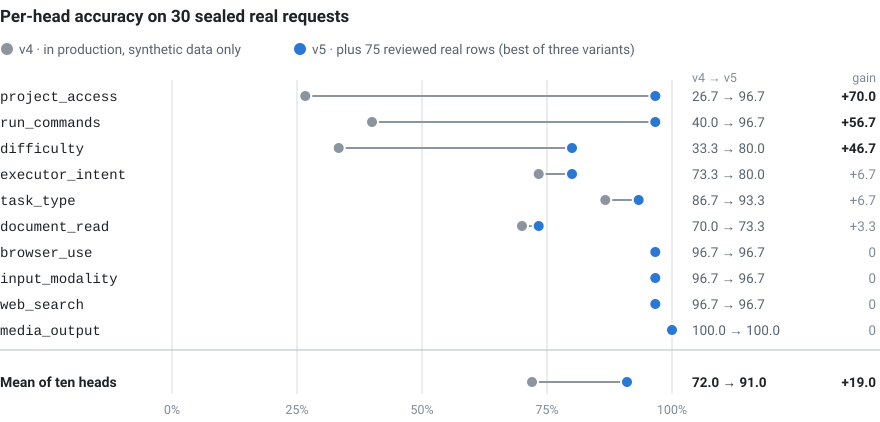

<h1>
  <picture>
    <source media="(prefers-color-scheme: dark)" srcset="docs/assets/ytw-logo-simple-mono-white-transparent.svg">
    
  </picture>
  Task Router
</h1>

**A 322M-parameter classifier and inference API that reads a request to an AI agent system and answers ten routing questions in one forward pass: what kind of task it is, how hard it is, and which tools it needs.** It routes requests in production in [PugPort](https://pugport.com), a multi-agent desktop app. A [Waytrine](https://wyt.si) project.

**[Case study](https://wyt.si/task-router/)** · **[API reference](https://wyt.si/task-router/api/)** · **[Model card](MODEL_CARD.md)**

<picture>
  <source media="(prefers-color-scheme: dark)" srcset="docs/assets/headline-dark.svg">
  
</picture>

<picture>
  <source media="(prefers-color-scheme: dark)" srcset="docs/assets/sealed-per-head-dark.svg">
  
</picture>

v4 was trained on synthetic data only and scored 97.8% on the synthetic test, but 72.0% on real requests: it underrated how hard real coding work is and missed when a request needs project write access and commands. Adding 75 reviewed real rows (v5) fixed exactly those heads. The sealed set is 30 real requests, one per task group, frozen before v5 training and scored once. On the same 30 items, v5 is 2-3 points behind fine-tuned models 2.5x and 12x its size and ahead of a 9B model used zero-shot ([details](eval/REAL_TRAFFIC.md)). Production runs v4; v5 is evaluated and rolling out next.

## How it works

<picture>
  <source media="(prefers-color-scheme: dark)" srcset="docs/assets/request-flow-dark.svg">
  
</picture>

- **Input** is a bounded state of five parts: the message, recent context, quoted reference text, attachment metadata (kind, name, MIME type; never contents) and the candidate executors.
- **Output** is one label per head, with probabilities. Four heads describe the task (`task_type`, `difficulty`, `input_modality`, `media_output`), four the tools it needs (`web_search`, `document_read`, `run_commands`, `browser_use`), and two its scope (`project_access`, `executor_intent`). Every label is listed in the [model card](MODEL_CARD.md#architecture).
- **The answers are advice.** They can never widen a permission: explicit user pins, approved rules, quotas, budgets and read-only limits always win, and a conflict is recorded and the advice dropped.
- **The client never waits on it.** PugPort calls with a deadline, falls back to rule-based routing on a miss or error, backs off for 30 s after an error, and pins the model version and the SHA-256 of the weights that every response reports.

Fine-tuned with the [Laya](https://github.com/NandhaKishorM/laya) framework from `convaiinnovations/laya-multilingual` (encoder `jhu-clsp/mmBERT-base`). Chinese and English. The service design (single-flight queue, stale-job dropping, logs without request bodies) is explained in the [API reference](service/API.md#design-decisions).

## Try it in two minutes

Python 3.11+ and the standard library only: no torch, no weights, no GPU.

```sh
git clone https://github.com/Waytrine/task-router.git
cd task-router
python -m unittest discover -s tests            # dataset integrity, scoring, service and API contract
python training/build_dataset.py --out runs/rebuild    # rebuilds the v1 splits byte for byte
python training/evaluate.py compare eval/synthetic/v3_test_report.json \
  eval/synthetic/v4_test_report.json --out runs/v3-vs-v4.md   # per-head table from the published reports
```

The service tests run the real ASGI app against a fake model, so they cover the queue, limits, error codes and log privacy without weights. Anything that runs the model needs a checkpoint, and **Task Router weights are not published yet**:

| To do this | You need |
|---|---|
| Run the tests, rebuild the dataset, compare reports | Python standard library |
| Score a checkpoint with `training/evaluate.py run` | `laya` and a local checkpoint; the public base model works |
| Run the inference service | `laya` and a complete local checkpoint with the same ten questions |

<details>
<summary><b>Score the public base model on the synthetic test set</b></summary>

```sh
python -m pip install -r requirements.txt     # Laya at the pinned training commit
python -c "from huggingface_hub import snapshot_download as d; d('convaiinnovations/laya-multilingual', \
  revision='1720e3e3357cfe1e281542e223f8273b0890ca34', local_dir='models/base')"
python training/evaluate.py run data/test.jsonl --model-dir models/base --out runs/base-test \
  --train-data data/train_v4.jsonl --device cuda     # or cpu / mps
```

`runs/base-test/report.json` holds per-head accuracy, macro F1, per-label recall, per-language accuracy and a majority-class baseline; `mistakes.csv` lists every wrong answer. To train your own checkpoint, use [`training/task_router_colab.ipynb`](training/task_router_colab.ipynb).

</details>

<details>
<summary><b>Run the service with a checkpoint</b></summary>

```sh
python -m pip install -r service/requirements.txt
TASK_ROUTER_CHECKPOINT=/path/to/checkpoint TASK_ROUTER_DEVICE=cpu python service/app.py
curl http://127.0.0.1:8787/v1/judge -H 'Content-Type: application/json' --data \
  '{"state": {"message": "Translate hello to French.", "recent_context": "", "reference_text": "",
              "attachments": [], "candidate_executors": []}}'
```

Deployment, limits and privacy: [`service/README.md`](service/README.md). Contract: [`service/openapi.yaml`](service/openapi.yaml).

</details>

## Repository map

| Path | What is there |
|---|---|
| [`MODEL_CARD.md`](MODEL_CARD.md) | Architecture, all labels, training data and procedure, evaluation, limitations. |
| [`data/`](data/) | The synthetic bilingual dataset: splits for every round, questions, hashes, provenance, label guide. |
| [`training/`](training/) | Dataset builder, evaluator and the Colab notebook for one training round. |
| [`eval/`](eval/) | Per-round synthetic reports, and the [real-traffic results](eval/REAL_TRAFFIC.md) with the open-model comparison. |
| [`service/`](service/) | The inference API: app, request contract, OpenAPI spec, [API reference](service/API.md), deploy examples. |
| [`tests/`](tests/) | Standard-library tests for all of the above. |

## Limits

- **The real-traffic holdout is small.** 30 sealed items; one item moves a head by 3.3 points. 26 of the 30 are coding requests and none asks for media output.
- **One user's traffic, agent labels.** The real requests come from the author's own use of PugPort and were labelled blind by AI agents with spot checks (69 cross-checked), not by human annotators.
- **The synthetic scores are regression numbers.** The 60-row synthetic test was reused across rounds and some later training rows are close rewrites of evaluation rows. The 72.0% v4 scored on real requests is the more honest measure of v4.
- **Label agreement only.** Task Router has not been compared end to end with an LLM judge or with PugPort's rule-based router.
- **Confidence is not a safeguard.** Raw confidences are high even on wrong answers.

How the splits, baselines and sealed set were built: [`eval/README.md`](eval/README.md).

## Attribution and license

Built on the [Laya framework](https://github.com/NandhaKishorM/laya) by Convai Innovations (Apache-2.0), the base model [`convaiinnovations/laya-multilingual`](https://huggingface.co/convaiinnovations/laya-multilingual) and the [`jhu-clsp/mmBERT-base`](https://huggingface.co/jhu-clsp/mmBERT-base) encoder. Task Router is an independent project, not a fork of Laya. Neither the base model nor any weights are included here; see [`ATTRIBUTION.md`](ATTRIBUTION.md).

Licensed under the [MIT License](LICENSE).
