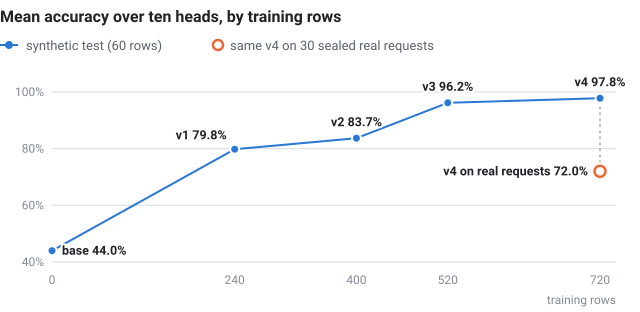

# Evaluation

All numbers are label agreement on held-out rows: **mean accuracy** over the ten heads, and **exact** = the share of rows with all ten heads right. They measure routing labels, not whether any task was then completed.

- Synthetic results (this file) come from the per-round reports in [`synthetic/`](synthetic/), produced by [`training/evaluate.py`](../training/evaluate.py) on Colab GPUs. In the copied reports only the `model_dir` path was replaced with a label.
- Real-traffic results are in [`REAL_TRAFFIC.md`](REAL_TRAFFIC.md), as aggregates only.

**Contents:** [Synthetic held-out test](#synthetic-held-out-test-60-rows-30-scenarios-600-decisions) · [Other synthetic sets](#other-synthetic-sets) · [Method](#method) · [Limits](#limits)

## Synthetic held-out test (60 rows, 30 scenarios, 600 decisions)

| Model | Training rows | Mean accuracy | Exact |
|---|---:|---:|---:|
| Majority class per head (from training labels) | | 69.7% | |
| Untuned base (`convaiinnovations/laya-multilingual`) | 0 | 44.0% | 0% |
| Task Router v1 | 240 | 79.8% | 21.7% |
| Task Router v2 | 400 | 83.7% | 31.7% |
| Task Router v3 | 520 | 96.2% | 70.0% |
| Task Router v4 | 720 | 97.8% | 78.3% |

<picture>
  <source media="(prefers-color-scheme: dark)" srcset="../docs/assets/synthetic-curve-dark.svg">
  
</picture>

The untuned base model scores below the majority-class baseline: it has never seen these ten questions' label conventions. The majority baseline is shown for v4's training labels.

Per head on test:

| Head | Base | v1 | v2 | v3 | v4 |
|---|---:|---:|---:|---:|---:|
| task_type | 23.3% | 55.0% | 65.0% | 90.0% | 98.3% |
| difficulty | 48.3% | 61.7% | 78.3% | 88.3% | 90.0% |
| web_search | 30.0% | 86.7% | 90.0% | 100.0% | 100.0% |
| input_modality | 28.3% | 86.7% | 88.3% | 98.3% | 100.0% |
| document_read | 51.7% | 85.0% | 86.7% | 96.7% | 100.0% |
| media_output | 58.3% | 76.7% | 81.7% | 95.0% | 100.0% |
| project_access | 56.7% | 80.0% | 80.0% | 96.7% | 96.7% |
| run_commands | 43.3% | 88.3% | 88.3% | 100.0% | 100.0% |
| browser_use | 28.3% | 86.7% | 86.7% | 100.0% | 100.0% |
| executor_intent | 71.7% | 91.7% | 91.7% | 96.7% | 93.3% |

v4 by language on test: Chinese 97.7%, English 98.0%. Rare labels are where the mean hides most: v4's `executor_intent` macro F1 over the labels present in test is 0.59.

## Other synthetic sets

**Validation (60 rows).** Used to choose what to add next, so later rounds are not independent of it.

| Model | Mean accuracy | Exact |
|---|---:|---:|
| Untuned base | 51.7% | 1.7% |
| Task Router v1 | 89.3% | 31.7% |
| Task Router v2 | 99.7% | 96.7% |
| Task Router v3 | 99.7% | 96.7% |
| Task Router v4 | 99.8% | 98.3% |

**Challenge, blind and independent sets:**

| Set | Rows | Model | Mean accuracy | Exact |
|---|---:|---|---:|---:|
| Fresh challenge set | 30 | v3 | 86.7% (260/300) | 20.0% |
| Fresh challenge set | 30 | v4 | 99.0% (297/300) | 90.0% |
| Blind set | 20 | v4 | 100% | 100% |
| Independent set | 24 | v4 | 93.3% (224/240) | 54.2% |

How to read them:

- **Fresh challenge set:** 30 new scenarios written and frozen before v3 was run on them. v4's added training rows include close rewrites of these scenarios, so the v4 score is a regression check only.
- **Blind set** ([`data/blind_test_v4.jsonl`](../data/blind_test_v4.jsonl)): 10 bilingual scenarios with template neighbours in `train_v4`, so a regression check only.
- **Independent set:** 12 Chinese + 12 English scenarios, labels frozen before inference, template-reviewed against training data.

v4 per head on the independent 24: task_type 23/24, difficulty 21/24, web_search 24/24, input_modality 21/24, document_read 22/24, media_output 24/24, project_access 23/24, run_commands 23/24, browser_use 23/24, executor_intent 20/24. The fresh and independent sets are not included in this repository.

## Method

- Splits are grouped by scenario family: a Chinese/English pair, contrast pairs and known near-duplicates always land in the same split. Across all published training files and evaluation files there is no shared family, scenario group or exact message (`tests/test_dataset.py` checks this).
- Only the five-part `state` and the questions reach the model; labels, tags and rationales never do.
- Missing, invalid or abstained answers count as wrong. Every run keeps per-row raw outputs and a mistakes file; nothing is filtered after the fact.
- The majority-class baseline is computed from the training labels only.

## Limits

- **The 60-row test split was reused across rounds.** The v2 test errors were inspected before rows were added for v3, so the v3 and v4 test scores are regression numbers, not unseen-test numbers. Validation was used the same way from round 1 on.
- **Synthetic sets are partly template-similar.** Some added training rows are close rewrites of evaluation rows (for example a validation row and a v2 training row that differ only in "user" vs "order" primary keys, character similarity about 0.99). Family IDs keep exact duplicates apart but cannot guarantee semantic independence.
- **Small sets.** 60, 30, 24 and 20 rows. Labels with one or two examples are descriptive only.
- **Synthetic is not real.** The same model that scored 97.8% here scored 72.0% on real requests; see [`REAL_TRAFFIC.md`](REAL_TRAFFIC.md).
- **Byte-level note.** The v3 and v4 Colab runs re-serialized the validation and test files, so the `data_sha256` in those reports differs from `data/manifest.json`. Their per-label supports are identical to the published files.
