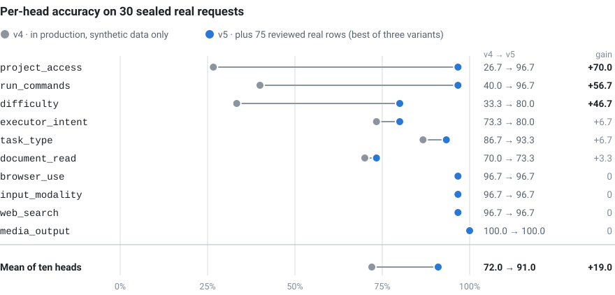

# Real-traffic evaluation (aggregates only)

Synthetic test scores said v4 was nearly done (97.8%). This evaluation checked that claim against real requests, found where it failed, and measured the fix (v5). No request text, identifier or per-item result is published; everything below is an aggregate.

**Contents:** [The data](#the-data) · [Task Router on the sealed 30](#task-router-on-the-sealed-30-300-decisions) · [What went wrong in v4, and the fix](#what-went-wrong-in-v4-and-the-fix) · [Other models](#other-models-on-the-same-sealed-30) · [Status](#status) · [Limits](#limits)

<picture>
  <source media="(prefers-color-scheme: dark)" srcset="../docs/assets/sealed-per-head-dark.svg">
  
</picture>

v5 shown is the best of three variants ("from base"); all three are in the table below.

## The data

- **Source:** the author's own use of PugPort. 392 labellable real requests in 86 task groups.
- **Privacy:** credentials are redacted by pattern before storage (private keys, auth headers, API keys of common providers, JWTs, bearer tokens, URL credentials), and file paths are removed before anything leaves the machine.
- **Labels:** assigned blind by AI agents, without seeing the model's prediction, with spot checks (69 items cross-checked). They are not human expert labels.
- **Sealed holdout:** 30 items, one per task group, frozen with a SHA-256 manifest before any v5 training. The 132 other records from those same groups were quarantined so nothing related could leak into training. The sealed set was scored once, after every v5 configuration was frozen.
- **Training candidates:** 110 reviewed items in 55 other groups. v5 used 75 for training and 35 for development.

Label distribution of the sealed 30 (shows what the set does and does not cover):

| Head | Supports |
|---|---|
| task_type | coding 26, research 2, writing 1, media 1 |
| difficulty | complex 22, standard 7, simple 1 |
| web_search | no 27, yes 3 |
| input_modality | text 29, video 1 |
| document_read | no 20, yes 10 |
| media_output | none 30 |
| project_access | write 14, read 13, none 3 |
| run_commands | yes 22, no 8 |
| browser_use | no 29, yes 1 |
| executor_intent | none 24, mention_only 5, reassign 1 |

## Task Router on the sealed 30 (300 decisions)

| Head | Majority class | v4 (production) | v5 continued, 1x | v5 continued, 3x | v5 from base |
|---|---:|---:|---:|---:|---:|
| task_type | 86.7% | 86.7% | 93.3% | 93.3% | 93.3% |
| difficulty | 23.3% | 33.3% | 83.3% | 76.7% | 80.0% |
| web_search | 90.0% | 96.7% | 96.7% | 100.0% | 96.7% |
| input_modality | 96.7% | 96.7% | 96.7% | 96.7% | 96.7% |
| document_read | 66.7% | 70.0% | 73.3% | 70.0% | 73.3% |
| media_output | 100.0% | 100.0% | 100.0% | 100.0% | 100.0% |
| project_access | 10.0% | 26.7% | 93.3% | 96.7% | 96.7% |
| run_commands | 26.7% | 40.0% | 96.7% | 93.3% | 96.7% |
| browser_use | 96.7% | 96.7% | 96.7% | 96.7% | 96.7% |
| executor_intent | 80.0% | 73.3% | 73.3% | 70.0% | 80.0% |
| **Mean** | **67.7%** | **72.0%** | **90.3%** | **89.3%** | **91.0%** |
| Exact (all 10 right) | | 3.3% | 26.7% | 20.0% | 40.0% |

The majority-class column always predicts each head's most common label in the training file; it is computed by the same evaluator.

The three v5 variants:

- **continued, 1x:** v4 trained further on the v4 synthetic rows plus the 75 real rows (795 rows).
- **continued, 3x:** the same, with the real rows repeated three times (945 rows).
- **from base:** the base model trained once on the same 795 rows.

v5 was trained on an NVIDIA L4.

## What went wrong in v4, and the fix

v4 was strong where the synthetic data matched real use (media_output 100%, web_search, input_modality and browser_use 96.7%, task_type 86.7%) and weak on difficulty (33.3%), project_access (26.7%) and run_commands (40.0%), barely above the majority-class baseline overall.

The cause was in the training data: the synthetic set under-represented long coding work that needs write access to a project and needs commands run, and the model underrated the difficulty of most real work. On 154 historical production judgments, v4's difficulty agreed with the reviewers 24.0% of the time.

Adding 75 reviewed real rows lifted exactly those heads. In the best variant (from base): difficulty 33.3% to 80.0%, project_access 26.7% to 96.7%, run_commands 40.0% to 96.7%; mean 72.0% to 91.0%.

The synthetic regression sets held up:

| Synthetic set | v4 | v5 continued, 1x | v5 continued, 3x | v5 from base |
|---|---:|---:|---:|---:|
| test (60) | 97.8% | 97.7% | 98.0% | 97.8% |
| fresh challenge (30) | 99.0% | 99.7% | 99.0% | 99.7% |
| blind (20) | 100.0% | 98.5% | 99.5% | 99.5% |

## Other models on the same sealed 30

Same ten-question schema, same sealed items; the fine-tuned models used the same v5 training data.

| Model | Size | Setting | Mean accuracy |
|---|---:|---|---:|
| H2O-Lightning-4B | 4B | LoRA fine-tuned | 94.0% |
| Intern-Decision-0.8B | 0.8B | fine-tuned | 93.0% |
| **Task Router v5 (from base)** | **322M** | fine-tuned | **91.0%** |
| elephant-1 | 9B | zero-shot | 90.3% |
| GLiNER2.5-multi | 287M | fine-tuned | 83.0% |
| Task Router v4 | 322M | fine-tuned on synthetic data only | 72.0% |

Task Router v5 is 2-3 points behind fine-tuned models 2.5x and 12x its size and ahead of a 9B model used zero-shot, while answering all ten heads in one encoder pass.

## Status

Production runs v4. v5 is trained and evaluated, rolling out next.

## Limits

- **30 sealed items is small.** One item moves a head by 3.3 points. Differences of a few points between v5 variants, or between v5 and the larger models, are within that noise.
- **Narrow coverage.** 26 of 30 sealed items are coding requests and none asks for media output, so the media and non-coding heads are barely tested here.
- **One user's traffic.** All requests come from the author's own usage of one app.
- **Agent labels.** Labels were assigned by AI agents with spot checks, not by human annotators.
- **No end-to-end comparison.** This measures label agreement. It does not compare routing outcomes against an LLM judge or against PugPort's rule-based router.
